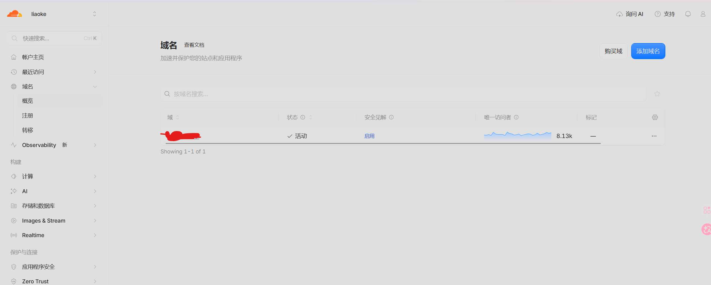
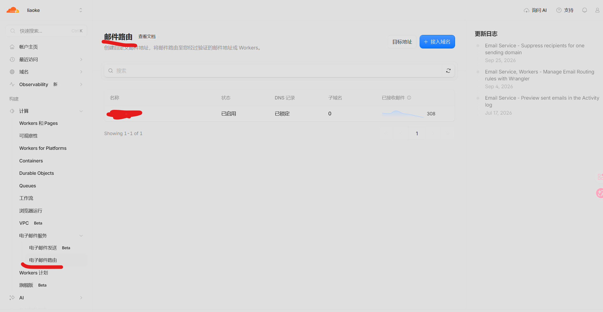
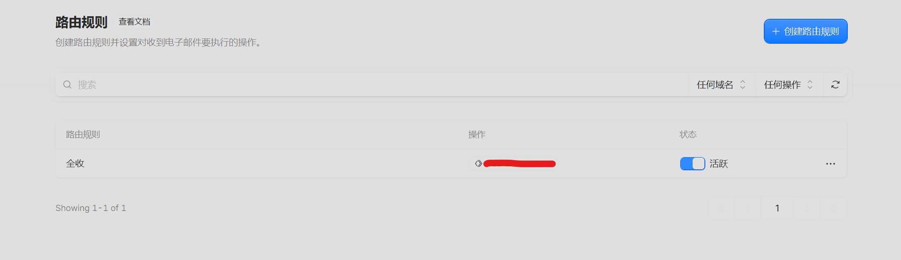
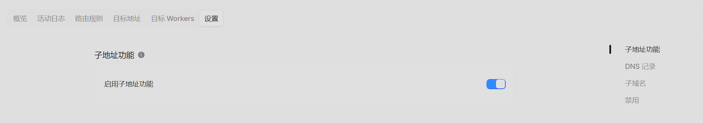
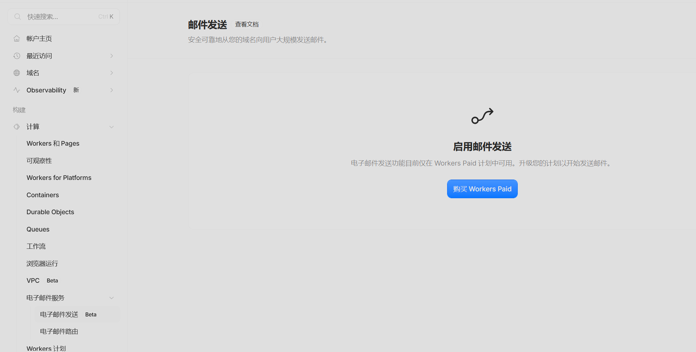

## 前言
有的时候遇到不信任的网站，但又需要注册，我们不方便用自己的主邮箱，于是我们便需要马甲邮箱或小号邮箱来进行注册。大量的马甲邮箱也可以用于新号注册有福利的场景，用来薅羊毛。于是我们便可以利用自己的域名和cloudflare提供的邮件路由功能实现自己域名的无限马甲邮箱。

## 准备
1. Cloudflare账号
2. 一个域名

## 操作

1. 将自己的域名托管到Cloudflare打开[Cloudflare](https://dash.cloudflare.com)根据引导将自己的域名托管到Cloudflare


2. 打开邮件路由页面并接入自己的邮箱


3. 最后创建路由规则,选择全收发生至自己的收件邮箱即可



## 补充
可以开启子路由功能,这样的话xx+1@xx.xx xx+2@xx.xx都算一个独立的邮箱。


其次，如果想实现复杂功能，建议全收发生至目标worker而不是收件邮箱。因为Cloudflare的默认规则是匹配的邮件只能进行设置的优先级最高的操作，无法进行多操作，但是我们转发至worker,可以在worker中随意怎么处理(发送到多个邮箱或和别的接口对接等等)。
以下是我的模板

```javascript
export default {
  async email(message, env, ctx) {
    // 1. 保存原始邮件到 R2（绑定变量名为 R2）
    const raw = await new Response(message.raw).arrayBuffer();

    const subject = message.headers.get("subject") || "无主题";
    const safeSubject = subject.replace(/[\\/:*?"<>|\r\n]+/g, "_").slice(0, 150);

    // 北京时间，精确到秒：YYYY-MM-DD_HH-MM-SS
    const stamp = new Date(Date.now() + 8 * 3600 * 1000)
      .toISOString()
      .slice(0, 19)
      .replace("T", "_")
      .replace(/:/g, "-");

    // 6 位随机后缀，避免同一秒、同主题的邮件互相覆盖
    const rand = crypto.randomUUID().slice(0, 6);
    const key = `${stamp}_${safeSubject}_${rand}.eml`;

    await env.R2.put(key, raw, {
      httpMetadata: { contentType: "message/rfc822" },
      customMetadata: { from: message.from, to: message.to },
    });

    // 2. 所有邮件转发到指定邮箱
    await message.forward("PRIMARY_FORWARD_EMAIL@example.com");

    // 3. 如果收件地址匹配指定地址，再额外转发一份
    if (message.to.toLowerCase() === "TRIGGER_EMAIL@example.com") {
      await message.forward("SECONDARY_FORWARD_EMAIL@example.com");
    }
  },
};
```

最后cloudflare其实还支持邮件转发功能，不过要付费

