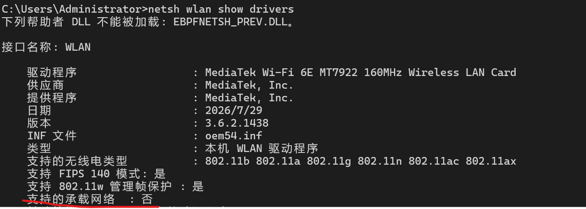
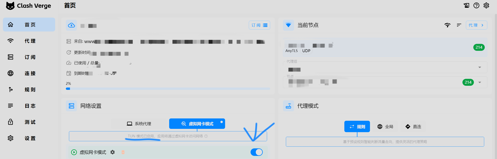
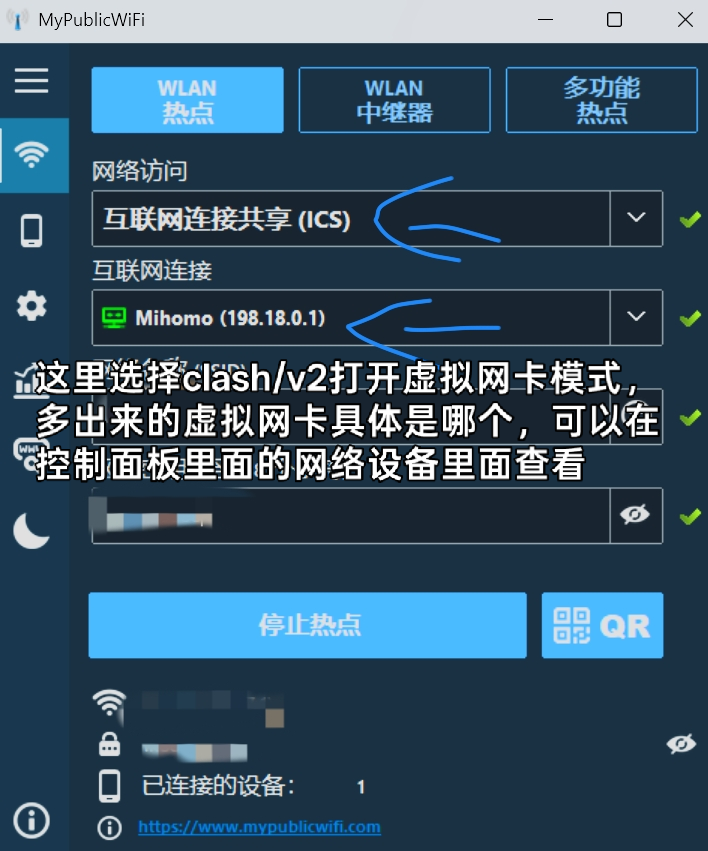

## 前言

接上一篇[文章](https://blog.liao-ke.com/posts/bypass-campus-wifi)，我把 Windows 版本更新到29704,无线网卡驱动到更新版本，发现此方法失效。初步推测是最新的网卡驱动不支持传统的承载网络功能了，所以在 Windows 自带的设置面板里面**打开热点是强制直接直连WLAN**,导致即使在控制面板里面设置了其他的网卡设备作为热点的上级网卡，也没法生效。所以因为部分设备的新版驱动和系统不支持网络承接功能，导致上一篇文章介绍的方法失效。因此，本篇文章将采用第三方热点软件的方式，进一步提升设备兼容性，同时简化整体操作流程。

## 操作步骤

### 1. 开启虚拟网卡模式

首先，使用 Clash、V2 等网络代理工具，开启软件中的 **TUN / 虚拟网卡模式**。

代理模式的选择：
- 如果已经配置了配置文件，保持默认规则模式即可。
- 如果**没有配置文件**，选择直连模式即可。

### 2. 配置第三方热点软件

下载并安装第三方软件[MyPublicWiFi](https://mypublicwifi.com/publicwifi/ch/index.html)，按照下图所示的方法进行配置。

最后两个选项分别用于设置热点名称（SSID）和热点密码，可以根据自己的需求随意填写。

## 总结

完成以上操作后，创建的共享热点即可供其他设备连接使用，并且能够避免校园网通过常规多设备接入检测识别出额外连接的设备。

相较于上一篇[文章](https://blog.liao-ke.com/posts/bypass-campus-wifi)介绍的方法，本方案在设备兼容性和操作简便性方面均有较大提升。
