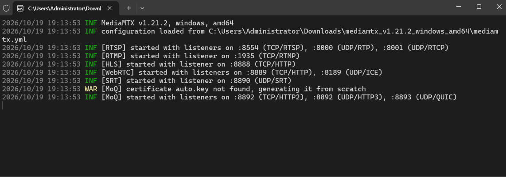
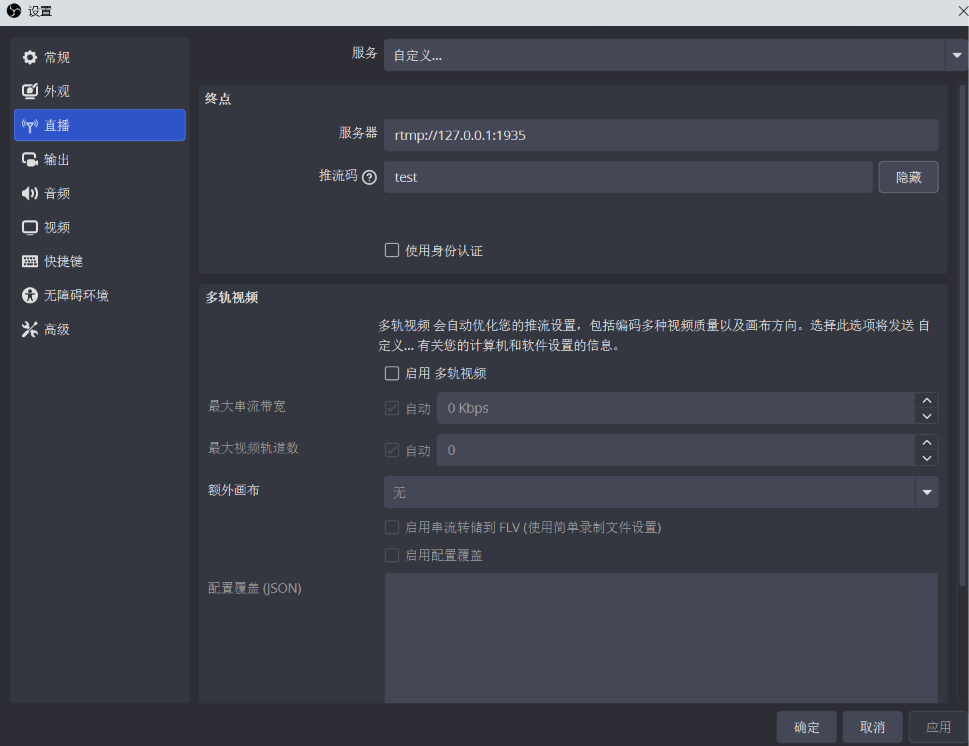
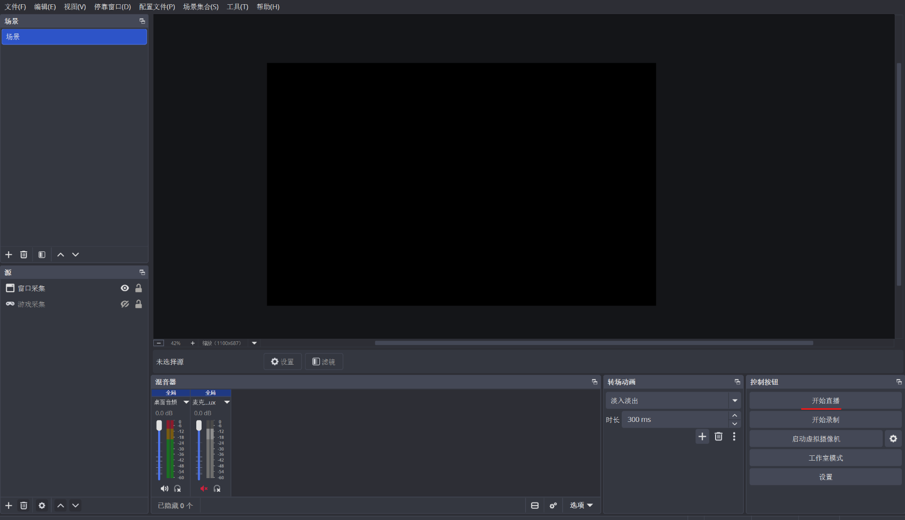

## 前言
QQ和微信的屏幕投屏的码率和流畅度太低了，于是便想到了在Windwos上用obs做源,mediamtx做RTMP服务器实现不受限制于qq与微信，直接用浏览器便可以看到任意的画面更流畅，码率更高的方案。

## 准备
1. OBS
2. mediamtx
3. 内网穿透或者公网端口映射

## 搭建
下载[OBS](https://obsproject.com/download)和[mediamtx](https://github.com/bluenviron/mediamtx/releases)。解压mediamtx后直接运行mediamtx.exe，RTMP服务器运行在1935端口。

打开OBS的设置，在直播里面按图所示填写，推流码随便填，填什么访问的网址后面的后缀就要写什么。

然后在OBS里面添加完源之后，直接点击开始直播，这个时候就可以直接通过浏览器访问了

HLS:http://127.0.0.1:8888/你的推流码/
WebRTC:http://127.0.0.1:8889/你的推流码/

以上两个协议都可以用，你的浏览器用哪个协议看起来码率更高更流畅就用哪个(不同的浏览器内核用不同的协议播放流畅度和码率会有较大差距，自行测试最适合自己浏览器内核的协议就行。)

## 映射和穿透
最后使用内网穿透，或者自己家里有公网，直接把8888或8889端口映射出去，就可以让别人访问了，这里就不展开细讲了。

