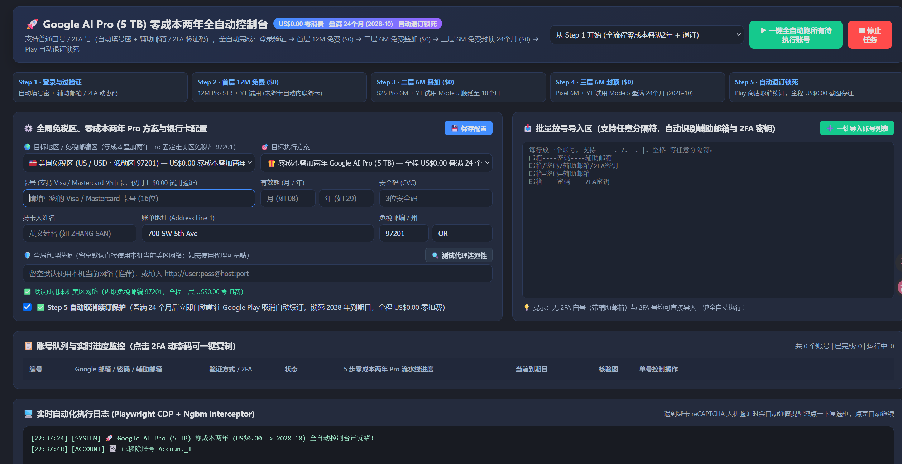

## 前言
最近很多卡密小店冒出了几十块卡谷歌两年AI pro和油管会员，在我的不懈努力下，也是成功找到了其项目的[开源地址](https://github.com/worldonlyu/Google_AI_Pro_2Year_ZeroCost_Auto)


## 准备
1. 一个谷歌小号（不要用大号，怕被封号）
2. 用于验证的visa或万事达的国际银行卡
3. Chrome浏览器
4. Python环境

## 分析

这个项目的整体思路其实不复杂：先登录账号，然后正常打开 Google One 的订阅页面。等页面准备发起结账请求的时候，把请求里面的优惠方案替换掉，最后再利用 Google Play 本身的订阅变更功能，把几次优惠接到同一个订阅后面。

### 登录和环境准备

程序使用 Playwright 控制 Chrome，自动完成输入邮箱、密码、辅助邮箱和 2FA 验证码这些操作。每个账号都有自己的 Chrome 数据目录，避免多个账号共用登录状态：

```python
user_data_dir = get_profile_dir(self.account["id"], self.account["email"])

chrome_args = [
    CHROME_PATH,
    f"--user-data-dir={user_data_dir}",
    "--webrtc-ip-handling-policy=disable_non_proxied_udp",
]
```

`--user-data-dir` 让每个账号使用独立的浏览器配置，代理和 WebRTC 参数则是为了让浏览器的网络环境和账号保持一致。这部分本质上只是自动化登录，并不是这个项目的关键。

### 关键：在结账请求发出前换掉优惠

真正关键的地方在结账页面。Google One 点击订阅之后，不是直接在当前页面完成付款，而是会创建一个结账 iframe。这个 iframe 的地址里带着一段 `ear` 参数，里面包含了商品、优惠和订阅变更信息。

项目没有去改 Google One 的页面，而是在页面脚本开始执行之前，先给浏览器装上一个 hook，专门监听 iframe 的 `src`。只要发现是结账地址，就把里面的参数解析出来，替换后再交给浏览器：

```javascript
const srcDesc = Object.getOwnPropertyDescriptor(HTMLIFrameElement.prototype, "src");
Object.defineProperty(HTMLIFrameElement.prototype, "src", {
  ...srcDesc,
  set(v) {
    if (typeof v === "string") v = rewriteUrl(v);
    return srcDesc.set.call(this, v);
  },
});
```

所以页面本身并不知道参数被改过。它还是照常加载结账页面、照常显示付款按钮，只是最终提交给 Google Play 的商品已经换成了项目指定的优惠方案。

项目还处理了另外两种创建结账请求的方式：`setAttribute("src")` 和 `TrustedTypePolicy.createScriptURL`。这是因为网页不一定总是通过 `iframe.src = url` 创建 iframe，只 hook 一种写法可能会漏掉请求。另外，Google 的部分请求走的是 XHR，所以代码也会检查请求体里的 `Ngbm`，把里面的商品参数一起替换掉。

### 为什么换一个参数就能得到优惠

这里需要先看懂 Google Play 的优惠是怎么传递的。项目在代码里直接保存了几组 offer token：

```python
# Universal across accounts/currencies
TOK_PRO5TB_12M = "AVbCH/..."    # 12 个月优惠
TOK_PRO5TB_6M = "AVbCH/..."     # 6 个月优惠
TOK_PRO5TB_6M_SS = "AVbCH/..."  # 另一组 6 个月优惠
```

这些 token 就是结账时使用的优惠标识。正常情况下，网页会把当前账号能使用的优惠填进去；这个项目做的事情，是在请求发出前把它换成另一组 token。也就是说，它没有修改结账页面显示出来的价格，而是修改了页面提交给结账服务的商品参数。

之所以能这样做，是因为这条结账链路把商品和优惠作为客户端参数提交，参数本身又没有额外签名。服务端收到请求后，主要根据商品 ID 和 offer token 判断这笔订单是什么优惠，而不是判断这个请求是不是由页面上的那个按钮产生的。只要 token 还有效，替换后的请求就有机会被正常处理。

这也解释了为什么项目不需要破解 Google 的加密。它并没有伪造服务器返回的数据，只是在浏览器里改了浏览器自己准备提交的数据。

### 为什么可以连续叠加两年

第一次优惠成功之后，项目不会重新创建一个完全独立的订阅，而是读取当前订阅的 ID，再把这个 ID 放进下一次结账请求：

```python
"ear8": [None, 5, None, None, None, [sub_id]]
```

这里的 `sub_id` 就是当前订阅，`5` 表示在原订阅上做变更。Google Play 对这种变更的处理方式，是把新的免费周期接在原来的到期日后面，而不是把原来的订阅覆盖掉。因此脚本先叠加 12 个月，再叠加两次 6 个月，最终就是 24 个月。

每次叠加后，程序都会重新读取 Play 订阅页面，确认到期时间确实往后推了，再继续下一步。最后再取消自动续订，避免免费期结束后自动按原价扣款。取消自动续订不会立即收回已经获得的周期，只是不再继续续费。

### 0 元是怎么保证的

项目并没有修改价格，也没有把支付按钮强行点下去。它会先读取结账弹窗里的文字，只有确认出现 `0.00`、`免费` 或 `Free` 时才继续：

```python
if "0.00" not in clean_txt and "免费" not in clean_txt and "Free" not in clean_txt:
    self.last_subscribe_error = "零消费保护拦截：弹窗未显示 0.00 免费试用"
    return False
```

如果结账页面没有显示免费，程序就会直接停止，不会点击订阅。账单地址则使用美国俄勒冈州的地址，因为当地不征收销售税，避免优惠本身是 0 元但最后又多出税费。

### 这套方法的问题

这套方法能运行，依赖的是几个比较特殊的前提：offer token 还没有失效，Google One 的结账参数结构没有变化，服务端也没有额外检查 token 的来源。一旦 Google 更换 token、给结账参数加签，或者把资格校验放回服务端，前面的 hook 就算还能运行，也无法再完成订阅。

项目目前主要靠页面文字判断结果，例如按钮名称、错误提示和订阅到期时间。Google 只要改一下页面结构或文案，自动化流程就可能失效。这也是它看起来能批量运行，但并不代表能够长期稳定使用的原因。

## 总结

这个项目的核心不是破解 Google，而是利用了结账流程中“优惠参数由浏览器提交”这一点。它先在浏览器里替换 offer token，再利用订阅变更的顺延规则把多个优惠接起来，最后通过取消自动续订保留已经获得的免费周期。

所以它能成功的原因，是优惠凭证、客户端请求和订阅变更这三个环节刚好可以串在一起；Google 只要把优惠和账号绑定、给请求增加完整性校验，或者限制优惠叠加，这套方法就会失效。

**这个是逆向谷歌的后端接口伪造请求来实现的，不同的优惠(并且由于谷歌没有验证账号是否有资格使用该优惠码的校验机制,所以这三个优惠码可能你的账号按照谷歌的使用条款并不适用，但是由于直接写死进了请求里,强制使用了优惠码，这可能违反了谷歌的使用条款,从而导致封号)叠加在一起,不建议大号使用，建议小号测试**