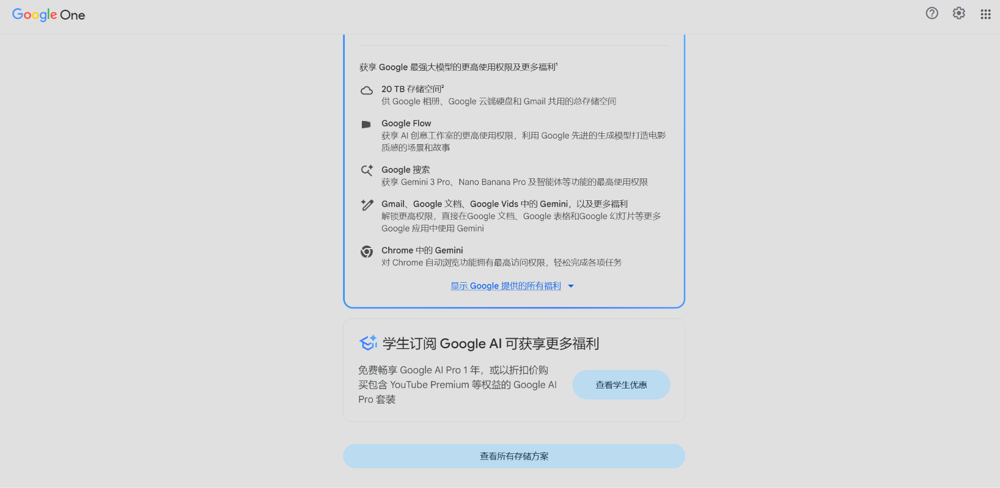
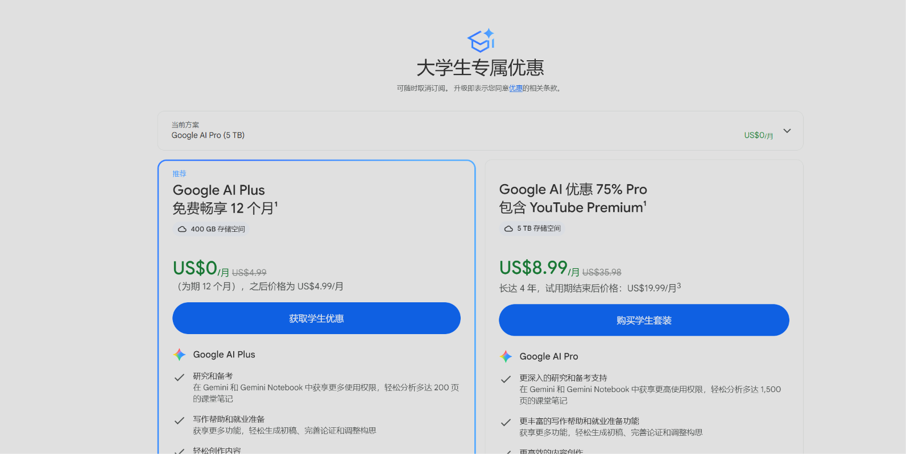
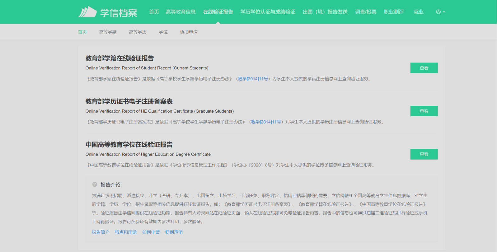

## 前言
最近Google的第三方学生身份平台SherrID支持了中国大陆的高校认证，所以中国大学生可以白嫖一年的学生订阅

## 准备
1. 一个Google账号
2. 一个美国节点(或者别的可以触发学生优惠的网络节点)
3. 学信网教育部学籍在线验证报告(没有可以P图)

## 认证过程
登录https://gemini.google.com/students
点击下方按钮(没有显示，就换一个真实的节点)

进入之后选择国家页面选择台湾
在高校搜索列表里面搜索自己的大学
最后上传下载的学信网教育部学籍在线验证报告PDF文件

## 结尾
完成以上步骤之后，耐心等个几天一周就可以认证通过。